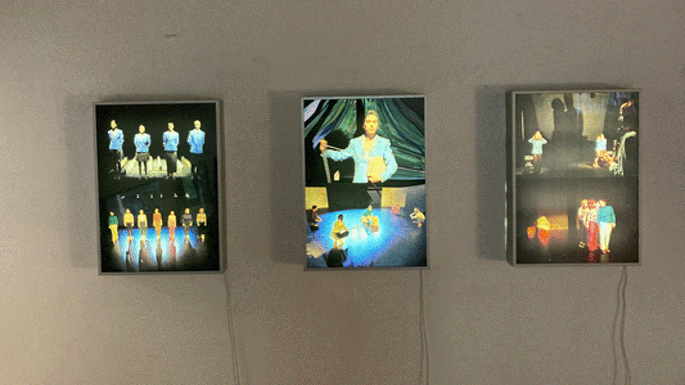
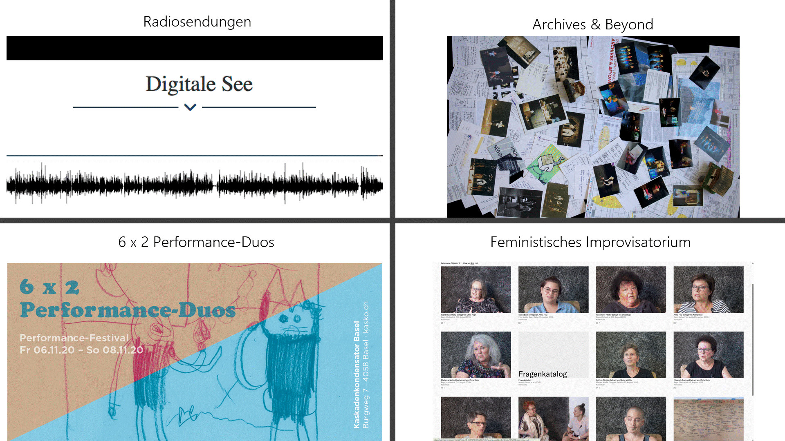

---
Title: Konvolute
Type: estate
CollectionTitle: Konvolute
Docs: 191
---

Die Konvolute oder kleine Sammlungen enthalten Dokumentationen, Beschreibungen und Wer-ke, die meist projektbasiert entstanden sind. Zu den Konvoluten gehören die Teilbestände:

- [**6x2 Performance Duos**](../../detail/zotero2-6117376.QISZ8U4J) – Ein von Pascale Grau kuratiertes Performanceprojekt im KASKO 2020 mit Performances sowie umfangreichen Reflexionen.
- [**ARCHIVES & BEYOND**](../../detail/zotero2-6117376.RIWE4UW7) – Ein von Pascale Grau und Dorothee Daphi kuratiertes, kollaborative Performanceprojekt zur Wiederaufführung des Stücks HAUSS(a)EGEN.

- Sowie die beiden Teilbestände der **Digialen See**: 
    - Interviews des [**Feministischen Improvisatoriums**](https://mediathek.hgk.fhnw.ch/ink/grid/de?search=Feministisches*+Improvisatorium&searchtype=all) zu 50 Jahren 1968
    - Zu den [**Radiosendungen**]() – Texte aus dem Dunstkreis
