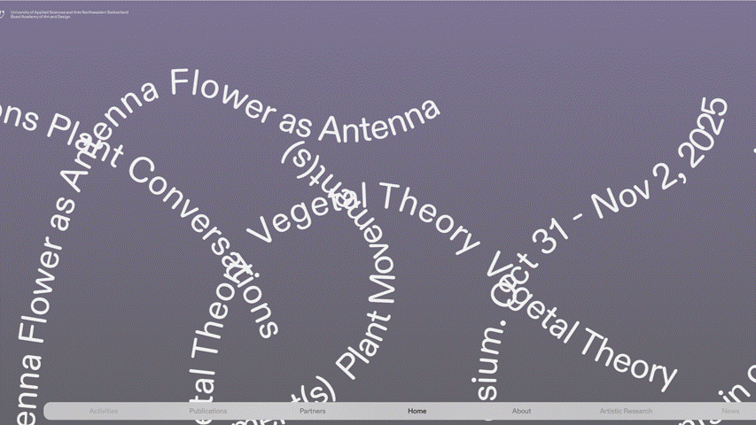

---
Title: Plant_Intelligence
Type: estate
CollectionTitle: Plant_Intelligence
Sourcetype: 
Collectionfield: Educational Resources; Practice Based Research; Open and Free Access
Docs: 79
---

## Learning like a Plant

The collection contains research data from the [SNSF-project Plant Intelligence](https://data.snf.ch/grants/grant/205110). This has explored the conceptualization of intelligence and its intertwining with concepts such as mind, consciousness, communication, memory, decision making, problem solving, learning, subjectivity. It asked whether this conceptualization makes sense of the behaviours of vege-tal life and whether it promotes new perspectives on interspecies and terrestrial relationships.
This question was based on the assumption that central reasons for the conjuncture of this terminology seem to lie in current debates about the Anthropocene: on the one hand, ways out of an exploitation-based understanding of the world were sought and the age of the Planthropocene (Natasha Myers) was proclaimed; on the other hand, with the rise of ma-chine-based services in everyday life, non-anthropocentric forms of intelligent ontologies and epistemologies were un-der scrutiny. Connected to this conjecture was the question of whether the recognition of vegetal forms of “intelli-gence” led to other methods of knowledge generation, coexistence, even breeding, dealing with pests, and ultimately to new, “intelligent” forms of plant, agricultural, and forestry culture. How far could the concept of intelligence be stretched, what would be gained or lost in the process, and what would the ethical and aesthetic implications?

These were the questions the team, consisting of three artists and an art scientist, are exploring in close collabora-tion with research partners from botany, seed and plant breeding as way of organic agriculture, food sovereignty, media ecology, and indigenous nations. Using the examples of laboratory experiments with plant interaction and decision-making, of propagation patterns of lichens and mosses in urban spaces, of indigenous plant-human alliances and GMO-critical practices in South America, im/possibilities of vegetal intelligence were elaborated, compared and inter-twined.

## Recherche

«Plants_Intelligence. Learning like a Plant» untersucht den Diskurs pflanzlicher Intelligenz in den Natur- und Geisteswissenschaften und den Künsten. Es untersucht die Begrifflichkeit und fragt, ob die Anerkennung vegetabiler Formen von «Intelligenz» zu anderen Methoden der Wissensgenerierung, des Zusammenlebens, von Züchtung und letztlich zu neuen, «intelligenten» Formen der Pflanzen- und Agrarkultur führten? Das Team, bestehend aus drei Künstler:innen und einer Kunstwissenschaftlerin, geht diesen Fragen in Zusammenarbeit mit Forschungspartner:innen aus der Botanik, der biologischen Züchtung, der Ernährungsgerechtigkeit, der Medienökologie und der Biokunst nach.An den Beispielen von Laborversuchen mit Pflanzen-Interaktion und Entscheidungsfindung in der Schweiz und Deutschland, von indigenen Pflanze-Mensch-Allianzen in Kolumbien und GMO-kritischen Praktiken in Argentinien werden Un/Möglichkeiten vegetabiler Intelligenz herausgearbeitet.

Das Projekt möchte die Debatte über Pflanzenwissen erweitern und durch die enge Zusammenarbeit mit Vertreter*innen aus verschiedenen Wissensgebieten für soziales, ökologisches und ethisches Verhalten fruchtbar machen.

Output: Serie von virtuellen Kolloquien, Workshops, Symposium, kommunale Dinners, Videoinstallationen, Karten, Zeichnungen, Wander-Ausstellung, webbasiertes Materialarchiv zum Transfer von Wissen. 

*(SNSF-project Plant Intelligence)*

### Personen 

**Projektverantwortliche/r**
- [Yvonne Volkart](https://mediathek.hgk.fhnw.ch/ink/grid/de?searchtype=author&search=Volkart%2c%20Yvonne)

**Mitarbeitender/in**
- [Felipe Castelblanco](https://mediathek.hgk.fhnw.ch/ink/grid/de?searchtype=author&search=Castelblanco%2c%20Felipe)
- Dominique Raemy
- [Julia Mensch](https://mediathek.hgk.fhnw.ch/ink/grid/de?searchtype=author&search=Mensch%2c%20Julia)
- Rasa Smite
- Romea Enzler

**Projektpartner/innen**
- [Ayenan John Quinchoa Juajibioy](https://mediathek.hgk.fhnw.ch/ink/grid/de?searchtype=author&search=Quinchoa%20Juajibioy%2c%20Ayenan)
- Birgit Schneider
- [Heraldo Vallejo Martinez](https://mediathek.hgk.fhnw.ch/ink/grid/de?searchtype=author&search=Vallejo%2c%20Heraldo)
- [Katja Tielbörger](https://mediathek.hgk.fhnw.ch/ink/grid/de?searchtype=author&search=Tielboerger%2c%20Katja)
- [Monika Messmer](https://mediathek.hgk.fhnw.ch/ink/grid/de?searchtype=author&search=Messmer%2c%20Monika)
- Ursula Damm

### Schlagwörter

- Critical Plant Studies, 
- Dekoloniales Denken, 
- Ernährungssouveränität, 
- Indigene Bewegungen, 
- Kunst, 
- Mensch-Pflanze-Allianzen, 
- Pflanzenintelligenz, 
- Pflanzenkommunikation, 
- Pflanzenverhalten, 
- Pflanzenzucht, 
- Techno-Öko-Feminismus, 
- Wissenschaft, 
- Ökologie